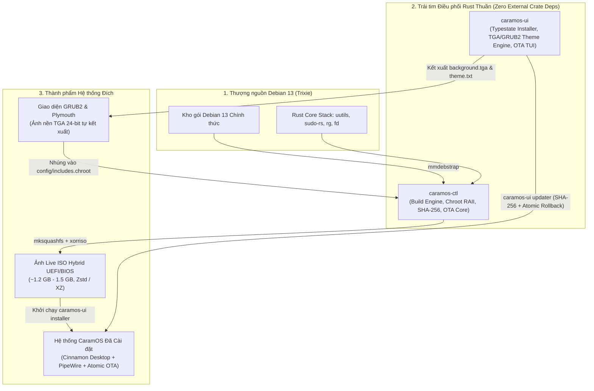

<p align="center">
  
</p>

<h1 align="center">CaramOS 2.0 — Debian 13 (Trixie) & Rust Core Edition</h1>

<p align="center">
  <strong>Hệ điều hành Desktop Linux an toàn bộ nhớ, khởi tạo trực tiếp từ thượng nguồn Debian 13 và vận hành 100% bằng công cụ hệ thống Rust thuần khiết.</strong>
</p>

<p align="center">
  
  
  
  
</p>

---

## I. Triết lý Kỹ thuật & Tầm nhìn Kiến trúc

**CaramOS 2.0 (`CaramOS-testing`)** là bản tái thiết kế toàn diện từ gốc nhằm giải quyết triệt để ba điểm nghẽn kiến trúc của thế hệ CaramOS 1.x cũ:

1. **Chấm dứt Phái sinh Chồng chéo 3 Tầng (`Debian -> Ubuntu -> Linux Mint -> CaramOS`)**: Thay vì tải tệp ISO Linux Mint nặng ~2.8 GB rồi giải nén SquashFS để xóa bớt gói, CaramOS 2.0 khởi tạo cây hệ thống tệp (`rootfs`) sạch 100% trực tiếp từ kho thượng nguồn **Debian 13 (`trixie`)** thông qua `mmdebstrap`.
2. **Loại bỏ Hoàn toàn Python & Bash trong Chuỗi Công cụ Cốt lõi**: Mọi tác vụ từ đóng gói ISO, quản lý điểm gắn kết ảo (`chroot`), kết xuất đồ họa Bootloader GRUB2/Plymouth, trình cài đặt tương tác cho đến cập nhật OTA đều được biên dịch thành hai thực thi Rust tĩnh duy nhất: `caramos-ctl` và `caramos-ui`.
3. **Thiết Quân Luật Bộ Nhớ (`#![forbid(unsafe_code)]` & Zero-Panic Policy)**: Không tồn tại `.unwrap()`, `.expect()`, hay `panic!` trong luồng vận hành thực tế. Mọi trạng thái hệ thống đều được kiểm chứng ở thời điểm biên dịch qua **Typestate Pattern** và giải phóng tài nguyên tự động bằng **RAII Guards**.

---

## II. Sơ đồ Kiến trúc Tổng thể Hệ sinh thái CaramOS 2.0



---

## III. Bảng Đối chiếu Kiến trúc: CaramOS 1.x vs. CaramOS 2.0

| Hạng mục Kỹ thuật | CaramOS 1.x (Di sản) | CaramOS 2.0 (Debian 13 & Pure Rust) |
| :--- | :--- | :--- |
| **Hệ điều hành Nền** | Linux Mint 22.3 (qua Ubuntu 24.04) | **Debian 13 (`trixie`)** trực tiếp từ thượng nguồn |
| **Khởi tạo Rootfs** | `unsquashfs` từ ISO Mint dựng sẵn | Bootstrap sạch bằng **`mmdebstrap`** |
| **Trình điều phối Build** | 10+ tệp Bash (`build.sh`, `scripts/*.sh`) | **`caramos-ctl`** (Rust thuần, RAII `ChrootMountGuard`) |
| **Trình Cài đặt & Giới thiệu** | Phụ thuộc hoàn toàn trình ngoài | **`caramos-ui installer`** (4 Slide giới thiệu + Typestate) + Calamares |
| **Giao diện Bootloader** | Cấu hình tĩnh rời rạc | **`caramos-ui bootloader`** (Tự kết xuất ảnh TGA 24-bit + GRUB2 Theme) |
| **Trình Cập nhật OTA** | Chuỗi script Python tuần tự dễ gãy | **`caramos-ui updater`** (Giao diện TUI + SHA-256 + Atomic Rollback) |
| **Bộ công cụ Userland** | GNU Coreutils & `sudo` truyền thống | **`uutils-coreutils`**, **`sudo-rs`**, **`ripgrep`**, **`fd-find`** |
| **Dung lượng Ảnh ISO** | ~2.8 GB – 3.1 GB | **~1.2 GB – 1.5 GB** (Giảm 50% dung lượng) |

---

## IV. Ba Phân hệ Giao diện & Trải nghiệm Mới (`caramos-ui`)

### 1. Trình Cài đặt Hệ điều hành có Giới thiệu Trực quan (`caramos-ui installer`)
* Hiển thị biểu trưng nghệ thuật ASCII **CaramOS 2.0** với bảng màu Caramel/Espresso.
* Trình chiếu **4 Trang Giới thiệu (Onboarding Carousel)** về kiến trúc Debian 13, Rust Core Stack, Cinnamon + PipeWire và cơ chế Atomic OTA.
* Sử dụng **Compile-Time Typestate Pattern** (`StageWelcome` $\rightarrow$ `StageTourCompleted` $\rightarrow$ `StageDiskValidated` $\rightarrow$ `StageUserConfigured` $\rightarrow$ `StageCommitted`) nhằm ngăn chặn tuyệt đối mọi thao tác ghi đĩa khi chưa qua bước kiểm định thiết bị khối (`/dev/nvmeXnY`, `/dev/sdX`).

```bash
# Chạy trình diễn trình cài đặt CaramOS 2.0 (chế độ Dry-Run an toàn):
make demo-installer

# Hoặc chạy chế độ tương tác hỏi đáp trực tiếp trên Terminal:
./crates/caramos-ui/target/release/caramos-ui installer --interactive --dry-run
```

### 2. Bộ Kết xuất Đồ họa Bootloader GRUB2 & Plymouth (`caramos-ui bootloader`)
* Tự động kết xuất tệp ảnh nền nhị phân **Truevision TGA 24-bit (`background.tga`)** ở độ phân giải HD/FullHD với hiệu ứng chuyển sắc Espresso và biểu tượng lục giác CaramOS ở trung tâm mà không cần bất kỳ thư viện xử lý ảnh bên ngoài nào.
* Tự động sinh tệp chủ đề GRUB2 (`/boot/grub/themes/caramos/theme.txt`), Plymouth Boot Splash (`/usr/share/plymouth/themes/caramos/`) và cấu hình nhân bảo mật `/etc/default/grub`.

```bash
# Kết xuất toàn bộ giao diện Bootloader vào cây thư mục Chroot:
./crates/caramos-ui/target/release/caramos-ui bootloader \
    --output-root ./config/includes.chroot \
    --width 1280 \
    --height 720
```

### 3. Trung tâm Cập nhật Hệ thống OTA Giao diện TUI (`caramos-ui updater`)
* Cung cấp bảng điều khiển TUI hiển thị kênh phân phối (`stable` / `testing`), phiên bản đích, thanh tiến trình đồ họa và trạng thái xác thực mật mã học **SHA-256 (FIPS 180-4)**.
* Đảm bảo tính nguyên tử 100%: Tạo bản sao lưu `.caramos-ota.bak`, nạp tệp mới vào `.caramos-ota.staging`, đồng bộ đĩa bằng `fsync` rồi mới hoán đổi nguyên tử. Nếu mất điện hoặc sai lệch mã băm, hệ thống tự động khôi phục tức thì.

```bash
# Thực thi giao dịch cập nhật OTA với giao diện TUI:
sudo ./crates/caramos-ui/target/release/caramos-ui updater \
    --root / \
    --target etc/caramos-release \
    --payload ./payload.new \
    --sha256 <SHA256_HEX_64_CHARS> \
    --version 2.0.1 \
    --channel stable
```

---

## V. Cấu trúc Kho Mã Nguồn Chuẩn Hóa

```text
CaramOS-testing/
├── .github/
│   └── workflows/
│       └── ci.yml                 # Pipeline CI/CD tự động: Kiểm định Clippy/Test -> Kết xuất UI -> Xuất ISO
├── assets/                        # Biểu trưng và tài nguyên thương hiệu CaramOS
├── config/
│   ├── includes.chroot/           # Cây thư mục nhúng thẳng vào Live ISO (Cinnamon, GRUB2 Theme, Binaries)
│   └── packages.txt               # Danh sách gói chuẩn hóa cho Debian 13 (Trixie) & Rust Core
├── crates/
│   ├── caramos-ctl/               # Trình điều phối đóng gói ISO, Chroot RAII & OTA Core (Zero Deps)
│   └── caramos-ui/                # Trình cài đặt TUI, Bộ kết xuất TGA/GRUB2 Bootloader & OTA Updater UI
├── docs/
│   └── ARCHITECTURE.md            # Hồ sơ thiết kế kỹ thuật chuyên sâu (Typestate, RAII, Threat Model)
├── packages/
│   └── caramos-app-center/        # Kho ứng dụng cho người dùng cuối
├── Makefile                       # Giao diện lệnh điều phối thống nhất
└── README.md                      # Tài liệu tổng quan dự án
```

---

## VI. Quy trình Đóng gói & Kiểm chứng Nhanh

```bash
# 1. Cài đặt công cụ nền tảng trên máy chủ build (Debian / Ubuntu):
sudo apt-get update && sudo apt-get install -y \
    cargo rustc clippy rustfmt \
    mmdebstrap debian-archive-keyring \
    squashfs-tools xorriso \
    grub-common grub-pc-bin grub-efi-amd64-bin mtools

# 2. Chạy kiểm định tĩnh (Clippy Martial Law) và toàn bộ Unit Tests:
make check
make test

# 3. Chạy mô phỏng toàn bộ quy trình (Kết xuất Bootloader + Installer + Build Dry-Run):
make dry-run

# 4. Đóng gói ảnh ISO CaramOS 2.0 chính thức:
make build      # Nén nhanh bằng Zstandard (zstd)
make release    # Nén tối đa bằng XZ Dictionary 100%
```

---

## VII. Giấy phép (License)

Dự án được phân phối dưới giấy phép **GNU General Public License v3.0 (GPL-3.0-only)**. Xem tệp [LICENSE](LICENSE) để biết thêm chi tiết.
