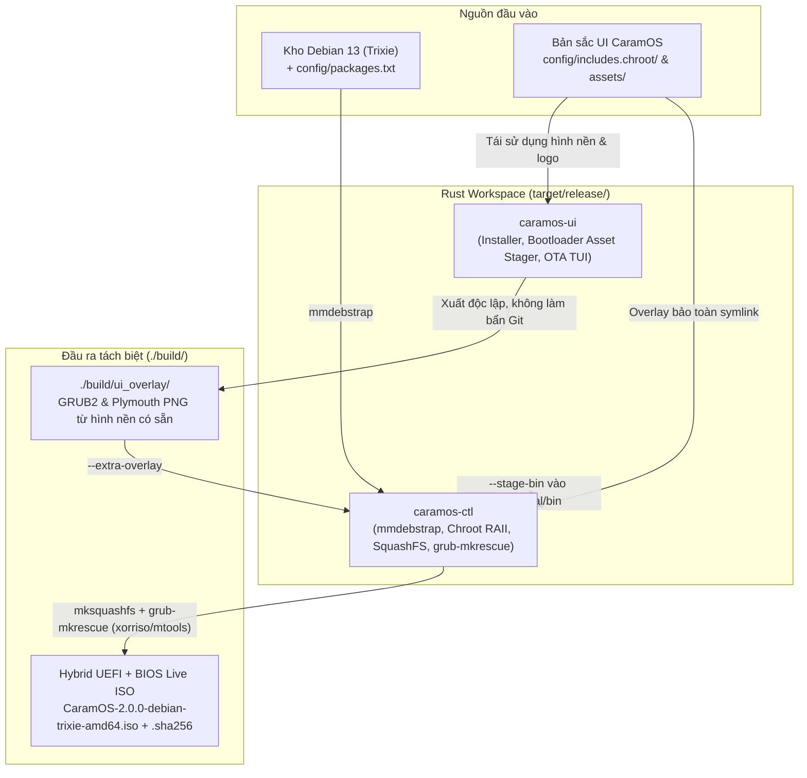

<p align="center">
  
</p>

<h1 align="center">CaramOS Testing — Debian 13 (Trixie) &amp; Rust Core</h1>

<p align="center">
  Nhánh phát triển và thử nghiệm tái cấu trúc hạ tầng cho <strong>CaramOS (VNLF)</strong>: dựng hệ thống trực tiếp từ Debian 13 (Trixie), thay thế các script Python/Bash rời rạc bằng công cụ Rust an toàn bộ nhớ, đồng thời giữ nguyên bản sắc giao diện của CaramOS.
</p>

<p align="center">
  
  
  
  
</p>

> [!WARNING]
> **Trạng thái dự án — Đang trong giai đoạn hoàn thiện (Work in Progress)**
> Kho mã nguồn này là nhánh thử nghiệm (`CaramOS-testing`) nhằm kiểm chứng kiến trúc mới trước khi đóng góp ngược lại cho dự án gốc **CaramOS của VNLF (VN-Linux-Family)**. Một số tính năng vẫn đang tiếp tục hoàn thiện và kiểm thử thực tế trên nhiều cấu hình phần cứng. Khuyến nghị chạy thử trên máy ảo (**QEMU / VirtualBox**) trước khi cài đặt lên máy sử dụng hằng ngày.

---

## 1. Mục tiêu của nhánh cải tiến này

Nhánh phát triển này tập trung giải quyết các hạn chế ở tầng hạ tầng xây dựng và công cụ hệ thống của CaramOS, mà không làm thay đổi trải nghiệm quen thuộc của người dùng cuối:

- **Gỡ bỏ mô hình phái sinh chồng chéo 3 tầng (`Debian → Ubuntu → Linux Mint → CaramOS`)**: Thay vì giải nén lại ảnh ISO trung gian rồi cắt gọt gói, hệ thống được khởi tạo trực tiếp từ kho thượng nguồn **Debian 13 (`trixie`)** bằng `mmdebstrap` theo danh sách gói kiểm soát trong `config/packages.txt`.
- **Thay thế chuỗi script `.py` và `.sh` rời rạc bằng Rust Workspace**: Toàn bộ quy trình build ISO, gắn kết chroot, đóng gói bootloader, trình cài đặt và cập nhật OTA được tập trung về 2 binary trong cùng một Cargo Workspace (`caramos-ctl` và `caramos-ui`), áp dụng `#![forbid(unsafe_code)]`, kiểm tra Clippy nghiêm ngặt (không `.unwrap()`/`.expect()`/`panic!`) và tự động dọn tài nguyên theo chuẩn RAII.
- **Giữ nguyên bản sắc UI của CaramOS**: Không tự sinh hình nền giả hay ghi đè nhận diện thẩm mỹ. Công cụ bootloader tự động tìm và tái sử dụng trực tiếp hình nền có sẵn trong `config/includes.chroot/usr/share/backgrounds/` cùng logo `assets/CaramOS_logo.png`; giai đoạn chroot biên dịch lại GSettings/dconf để giữ trọn vẹn cấu hình Cinnamon đặc trưng của CaramOS.
- **Thân thiện và an toàn cho người dùng phổ thông**: Cả chế độ Live lẫn hệ thống sau cài đặt đều vận hành bằng tài khoản người dùng thường (`sudo`); trình cài đặt chặn việc tạo tài khoản `root` và tự động khóa đăng nhập trực tiếp bằng `root` (`passwd -l root`).

---

## 2. Tổng quan kiến trúc



### So sánh nhanh giữa quy trình cũ và hướng tiếp cận mới

| Thành phần | Quy trình cũ | Hướng tiếp cận trong `CaramOS-testing` |
| :--- | :--- | :--- |
| **Hệ điều hành nền** | Phái sinh qua Ubuntu / Linux Mint | **Debian 13 (`trixie`)** trực tiếp từ thượng nguồn |
| **Đóng gói Rootfs & ISO** | Nhiều script Bash rời rạc | **`caramos-ctl`** (`mmdebstrap`, `ChrootMountGuard`, `mksquashfs`, `grub-mkrescue`) |
| **Khởi động ISO** | Phụ thuộc cấu hình ngoài | **Hybrid UEFI + Legacy BIOS** (tự kiểm định El Torito & EFI trên CI) |
| **Bootloader & Splash** | Cấu hình tĩnh / tự tạo ảnh nền | **`caramos-ui bootloader`** tái sử dụng trực tiếp hình nền có sẵn của CaramOS |
| **Trình cài đặt** | Phụ thuộc script ngoài | **`caramos-ui installer`** (chọn ổ đĩa `lsblk`, tạo user thường, ẩn mật khẩu, khóa `root`) |
| **Cập nhật OTA** | Script Python tuần tự | **`caramos-ui updater`** (truyền luồng `O(1)` RAM, SHA-256 `sha2`, `fsync` + rollback nguyên tử) |
| **Quản lý nhị phân & Git** | Dễ lọt `target/` hoặc binary vào repo | Tách hoàn toàn sang `target/` và `./build/`, có CI Guard chặn commit nhị phân |

---

## 3. Hai thành phần Rust cốt lõi

### `caramos-ctl` — Điều phối build ISO & tác vụ hệ thống
- Kiểm tra công cụ máy chủ trước khi chạy (`mmdebstrap`, `mksquashfs`, `grub-mkrescue`, `xorriso`, `mformat`, mô-đun GRUB BIOS/UEFI).
- Bảo vệ môi trường chroot bằng RAII (`ChrootMountGuard` tự tháo `proc`, `sys`, `dev`, `dev/pts`, `run`; `ChrootPolicyRcGuard` chặn daemon khởi chạy trong lúc build và tự gỡ khi kết thúc).
- Đồng bộ `config/includes.chroot/` bảo toàn đầy đủ symlink và phân quyền; biên dịch `glib-compile-schemas`, `dconf update`, `plymouth-set-default-theme` và `update-initramfs` trước khi nén SquashFS.
- Hỗ trợ `--extra-overlay` và `--stage-bin` để nhúng binary Rust trực tiếp vào `rootfs/usr/local/bin/` mà không làm bẩn thư mục nguồn trên Git.
- Đóng gói Hybrid UEFI + BIOS ISO bằng `grub-mkrescue` kèm kiểm chứng SHA-256 phần cứng (`sha2`).

### `caramos-ui` — Trải nghiệm cài đặt, Bootloader & OTA TUI
1. **`installer`**:
   - Quét và đánh số ổ đĩa vật lý bằng `lsblk` để chọn nhanh, cho phép nhập lại khi sai.
   - Thiết lập tài khoản người dùng chuẩn: Họ tên hiển thị (hỗ trợ tiếng Việt UTF-8), tên đăng nhập (cấm `root`), mật khẩu nhập ẩn 2 lần (`rpassword`), tùy chọn tự đăng nhập LightDM, tên máy tính và múi giờ.
   - Áp dụng **Typestate Pattern** ở thời điểm biên dịch; ở chế độ `--execute`, yêu cầu xác nhận rõ (`CAI DAT` hoặc `--confirm-erase-disk`), gán đầy đủ nhóm Desktop, đặt mật khẩu qua pipe `chpasswd`, khóa tài khoản `root` (`passwd -l root`) và cài GRUB tự nhận UEFI/BIOS.
2. **`bootloader`**:
   - Quét và tái sử dụng hình nền có sẵn trong `config/includes.chroot/usr/share/backgrounds/` (ưu tiên nền tối để menu rõ nét) và logo `assets/CaramOS_logo.png`.
   - Chuẩn hóa ảnh sang PNG RGB8 tương thích GRUB2 và Plymouth vào thư mục overlay tạm (`./build/ui_overlay`), không tự vẽ ảnh nền thay thế.
3. **`updater`**:
   - Giao diện dòng lệnh hỗ trợ cả chế độ tham số tự động lẫn `--interactive`.
   - Băm SHA-256 theo luồng (`64 KiB` bộ đệm, không nạp toàn bộ gói vào RAM), ghi tệp tạm cùng phân vùng bằng `tempfile`, đồng bộ `fsync`, đổi tên nguyên tử và tự khôi phục từ bản sao lưu nếu phát sinh lỗi.

---

## 4. Cấu trúc kho mã nguồn

```text
CaramOS-testing/
├── .github/workflows/ci.yml   # CI kiểm tra chống commit binary, Clippy, Test, Dry-Run & Build Hybrid ISO
├── Cargo.toml                 # Cargo Workspace gốc (quản lý chung dependencies & profile release)
├── Makefile                   # Tập lệnh thống nhất (check, test, stage-ui, demo-installer, dry-run, build)
├── assets/                    # Logo và tài nguyên thương hiệu CaramOS
├── config/
│   ├── includes.chroot/       # Lớp phủ giao diện, hình nền, theme và cấu hình gốc của CaramOS
│   └── packages.txt           # Danh sách gói Debian 13 (Trixie) cho Live ISO & Cinnamon Desktop
├── crates/
│   ├── caramos-ctl/           # Bộ điều phối build ISO, Chroot RAII, SHA-256 & OTA core
│   └── caramos-ui/            # Trình cài đặt thân thiện user, Bootloader stager & OTA TUI
├── docs/                      # Tài liệu thiết kế và ghi chú kỹ thuật
└── packages/                  # Các gói ứng dụng đi kèm của CaramOS
```

---

## 5. Hướng dẫn build & chạy thử cục bộ

### Bước 1: Cài đặt gói cần thiết trên máy build (Debian / Ubuntu)

```bash
sudo apt-get update && sudo apt-get install -y \
    mmdebstrap squashfs-tools xorriso \
    grub-common grub-pc-bin grub-efi-amd64-bin \
    mtools dosfstools ca-certificates
```

*(Yêu cầu Rust toolchain ổn định >= 1.85 với `cargo`, `clippy`, `rustfmt`.)*

### Bước 2: Kiểm tra mã nguồn, chạy test và thử trình cài đặt (an toàn)

```bash
# Chạy Clippy nghiêm ngặt, Unit Tests và biên dịch release cho toàn bộ Workspace
make all

# Trải nghiệm luồng tương tác của trình cài đặt ở chế độ Dry-Run (không chạm ổ cứng)
make demo-installer

# Kiểm tra bước chuẩn bị Bootloader từ hình nền sẵn có và chạy mô phỏng pipeline ISO
make stage-ui
make dry-run
```

### Bước 3: Xuất ảnh Live ISO Hybrid UEFI/BIOS

```bash
make build      # Nén SquashFS nhanh bằng Zstandard (phù hợp phát triển & test)
make release    # Nén SquashFS tối đa bằng XZ (phù hợp phát hành)
```

Ảnh ISO đầu ra nằm tại `./build/CaramOS-2.0.0-debian-trixie-amd64.iso` kèm tệp kiểm tra `./build/CaramOS-2.0.0-debian-trixie-amd64.iso.sha256`.

### Bước 4: Chạy thử ISO trên máy ảo QEMU

```bash
# Kiểm thử Legacy BIOS
qemu-system-x86_64 -enable-kvm -m 4096 -smp 2 \
    -cdrom build/CaramOS-2.0.0-debian-trixie-amd64.iso

# Kiểm thử UEFI (cần cài gói ovmf)
qemu-system-x86_64 -enable-kvm -m 4096 -smp 2 \
    -bios /usr/share/ovmf/OVMF.fd \
    -cdrom build/CaramOS-2.0.0-debian-trixie-amd64.iso
```

---

## 6. Tiến độ hiện tại & Hạng mục đang hoàn thiện

- [x] Chuyển toàn bộ công cụ build và hệ thống sang Cargo Workspace (`caramos-ctl`, `caramos-ui`) không `unsafe`.
- [x] Khởi tạo Rootfs trực tiếp từ Debian 13 (Trixie) bằng `mmdebstrap`, bảo toàn symlink overlay và biên dịch GSettings/dconf trong chroot.
- [x] Đóng gói Hybrid UEFI + Legacy BIOS ISO bằng `grub-mkrescue` và tự động kiểm định El Torito/EFI trên GitHub Actions.
- [x] Tái sử dụng hình nền và logo có sẵn của CaramOS cho GRUB2/Plymouth; tách sạch binary và artifact khỏi Git.
- [x] Trình cài đặt TUI tạo tài khoản người dùng thường, ẩn mật khẩu và khóa tài khoản `root`.
- [ ] Kiểm thử toàn diện cài đặt thực tế trên nhiều dòng phần cứng (UEFI Secure Boot, laptop Wi-Fi/Bluetooth, GPU rời).
- [ ] Tối ưu tinh gọn thêm `config/packages.txt` và hoàn thiện trải nghiệm cài đặt đồ họa (nếu cần song song với TUI).
- [ ] Hoàn thiện luồng phát hành và kiểm thử OTA end-to-end từ máy chủ cập nhật thực tế.
- [ ] Rà soát và đề xuất đóng góp các cải tiến ổn định về kho chính thức của **CaramOS (VNLF)**.

---

## 7. Đóng góp & Ghi nhận

- Dự án gốc: **CaramOS — VN Linux Family (VNLF)**. Nhánh này kế thừa và tôn trọng bản sắc giao diện, bộ tài nguyên và định hướng vì người dùng Việt của cộng đồng CaramOS.
- Mọi báo lỗi khi build ISO, phản hồi trải nghiệm boot/cài đặt trên máy ảo hoặc phần cứng thật và Pull Request cải tiến Rust đều rất được hoan nghênh qua mục **Issues** và **Pull Requests** (xem thêm [CONTRIBUTING.md](CONTRIBUTING.md)).

---

## 8. Giấy phép

Dự án được phát hành theo giấy phép **GNU General Public License v3.0**. Xem chi tiết tại tệp [LICENSE](LICENSE).
